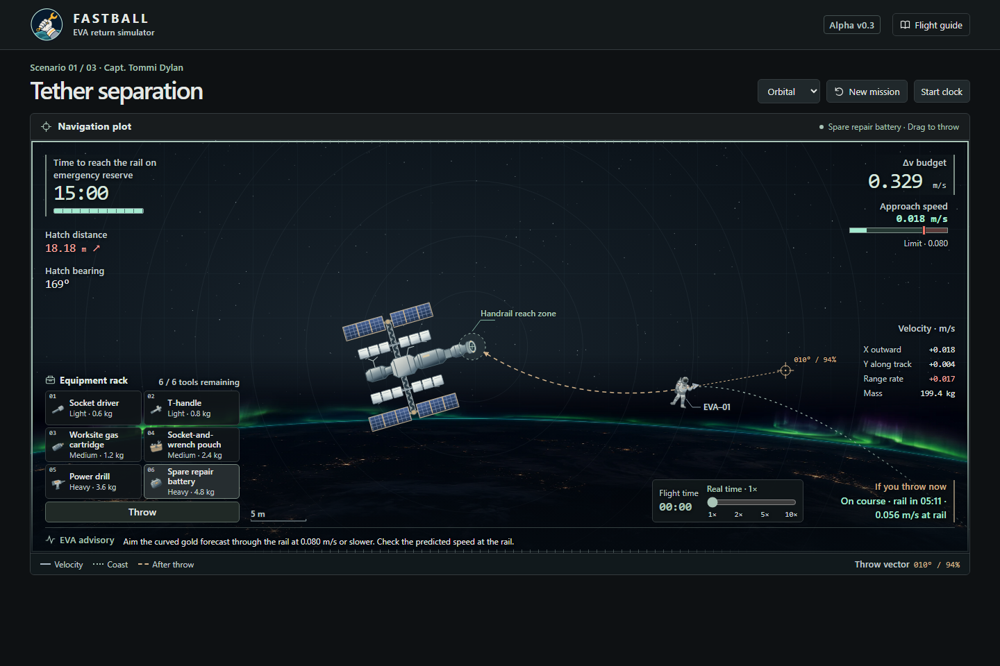

# Fastball · Alpha v0.3

[Play Fastball on GitHub Pages](https://lamcnamara.github.io/fastball/)

Capt. Tommi Dylan (she/they) was the first test pilot to break Mach 10 in the classified SR-73 reconnaissance craft. These days she spends Saturdays pitching with friends, sometimes against the next town over. Now her tether has snapped and the thrusters on her lightweight prototype suit are stuck closed. Eighteen metres from the handrail, the former high school star pitcher reaches for the wrench pouch.

## Fly your first rescue

1. Follow the gold ring in **First rescue** to aim the pouch away from the hatch. The pouch travels toward your crosshair and your suit recoils in the opposite direction. Releasing the first throw starts the clock.
2. Check **Current coast** after the throw. On Easy, it tells you whether your path reaches the handrail in time. When it does, **Coast to halfway** advances the flight to the course check. The station calls once when the original gap to the rail has halved.
3. If the path still crosses the reach zone, use **Coast to rail** or let the clock run. If you’ll miss, use a light tool to trim your course. On Medium, Hard and Orbital, also check your approach speed. Throwing along your velocity arrow slows you down.

**Skip guidance** lets you fly independently. Open **Flight guide** to read the manual or restart the guided rescue. For offline play, download `index.html` and open it in a browser. The game and its artwork are self-contained.

## Equipment rack

The lower-left HUD holds two tools per row. Read left to right, from the lightest tools at the top to the heaviest at the bottom. On narrow screens the rack sits directly below the aiming area. Each button shows the tool's artwork, name, weight class and mass. The selected tool has a lighter charcoal fill. After a throw, its slot fades to a translucent dashed outline marked **Released**. Story mode reloads the tool immediately.

| Key | Equipment | Class | Mass |
| --- | --- | --- | ---: |
| 1 | Socket driver | Light | 0.6 kg |
| 2 | T-handle | Light | 0.8 kg |
| 3 | Worksite gas cartridge | Medium | 1.2 kg |
| 4 | Socket-and-wrench pouch | Medium | 2.4 kg |
| 5 | Power drill | Heavy | 3.6 kg |
| 6 | Spare repair battery | Heavy | 4.8 kg |

Both mass and release speed affect recoil. The **Δv budget** estimates how much total velocity change your remaining equipment can deliver with full-power throws in the best order.

## Aim, throw and control time

| Action | Control |
| --- | --- |
| Select a tool | Click or tap its button, or press **1–6**. |
| Preview a throw | Click or tap the plot. The crosshair sets the tool's bearing. Distance from the suit sets power from 10% to 100%. Press **Throw** beneath the rack to release the selected tool. |
| Throw in one gesture | Drag on the plot or from the crosshair, then release. The dotted ring marks full power. **Escape**, releasing outside the plot, or releasing over the rack or flight clock cancels the drag. |
| Fine-tune aim | With the plot focused, use **← / →** for 1° bearing steps and **↑ / ↓** for 1% power steps. Left increases the bearing counterclockwise. Right decreases it clockwise. Hold **Shift** for steps of 10. Press **Enter** to throw. |
| Wind up | Hold **Space**, then release to throw. With a tool button focused, Space uses that tool. **Escape** cancels the windup. |
| Start, pause or resume | Use the clock button beside **New mission**, or press **P**. Switching tabs or windows pauses a running flight. A paused plot fades to grey and shows **PAUSED** at its center. [View the paused HUD](preview-paused.png) |
| Change flight speed | The flight-clock slider inside the lower-right corner of the plot offers **1×, 2×, 5× and 10×**. Amber indicates fast-forward. Move the slider to take over from an automatic coast. |

**Hatch distance** measures the gap to the edge of the handrail reach zone. Green distance and negative radial speed mean you’re closing. Red distance and positive radial speed mean you’re drifting away. **Hatch bearing** points toward the rail, with 000° to the right and 090° up. **Approach speed** measures total speed relative to the station, including sideways drift.

## Missions and difficulty

Under **New mission**, choose **Tether separation**, **Lateral drift**, **Wide separation**, or **Random**. The scenario sets your starting position and drift. Difficulty sets the flight rules. All four scenarios support all five difficulties. **Retry this flight** restores the opening, rules and bonus objective.

| Scenario | Opening | First decision |
| --- | --- | --- |
| Tether separation | Slow outward drift, 18.2 m from the edge of the reach zone. | Start here on Easy. Preview the pouch and see how reversing the outward drift changes the coast. |
| Lateral drift | Sliding across the hull, 14.5 m from reach. | Throw partly in the direction of the sideways drift to cancel it. Check whether the resulting coast crosses the rail. |
| Wide separation | Moving away, 28.9 m from reach. | Budget for a strong opening throw and keep a light tool for a later correction. |
| Random | A seeded position, speed and heading. | Read the initial range and velocity before choosing a tool. Share the seed to compare routes from the same start. |

### Choose a difficulty

| Mode | Return reserve | Navigation and capture |
| --- | --- | --- |
| Story | Unlimited | Full coast and throw forecasts. Tools reload. Grab the rail at any speed, or drift completely out of view to end the flight. |
| Easy | 15 minutes | Full trajectory, intercept-time and miss-distance forecasts. Any capture speed is allowed. |
| Medium | 10 minutes | The HUD previews the velocity a throw would produce. Reach the rail at **0.080 m/s or slower**. |
| Hard | 7 minutes 30 seconds | Navigate by raw telemetry. The same capture limit applies, and each release can stray up to **2°** either side of the selected bearing. |
| Orbital | 15 minutes | Curved coasts, full previews and precise releases. Enter the 1.2 m handrail zone at **0.080 m/s or slower**. |

The approach gauge shows the 0.080 m/s reference in every mode. On Medium, Hard and Orbital it turns red above the capture limit. An empty rack can still get you home if your final coast reaches the rail in time at a permitted speed.

For a replay, try keeping the original drill holstered or returning in two throws or fewer. The station gives Tommi a different welcome on each difficulty. Bring the original drill home to earn **Upmass Hero**, whichever bonus objective you picked. The mission debrief lets you review the plot, retry the same flight, or take the next challenge.

### Course corrections

- **Read the range and the arrow together.** A shrinking gap can still lead to a flyby. On Medium, compare the predicted velocity arrow with the hatch bearing. On Hard, check the measured velocity after each throw because the actual bearing can vary.
- **Brake while you still have room.** Throwing in the direction your suit is moving reduces that velocity component. On Medium, Hard and Orbital, the speed limit applies at the first crossing of the reach zone. On Orbital, check the projected speed at the rail as well as the current gauge.
- **Let a good coast run.** Once your route reaches the rail safely within the reserve, **Coast to halfway** takes you to the course check. **Coast to rail** then advances the final approach. The flight-speed slider returns control to you during an automatic coast.

### Share a random rescue

1. Choose **Random** to draw a starting position, drift speed and direction. **Generate seed** deals another start. The preview gives the initial distance from the hatch, speed and heading.
2. Use **Copy link** in setup or beside the seed during flight. Opening the link starts the same drift with the sender’s difficulty and bonus objective. Hard rolls a fresh release error each time a tool is thrown.
3. To enter a flight manually, paste its Scenario Seed or full link under **New mission → Random** and choose **Load seed**, then **Begin mission**. An `O1` seed always selects Orbital, even when a shared link specifies a different difficulty. A bare `F1` seed keeps your selected difficulty and objective. In Orbital, loading an eligible `F1` start creates an `O1` code for those same coordinates. Offline players can exchange just the code. For a two-throw Hard playtest, try `F1N73CGPHF`.

**Seed format.** Each ten-character code starts with `F1` for the original flight model or `O1` for Orbital. The next seven base-36 characters pack the initial X and Y coordinates in decimetres and the X and Y velocity components in millimetres per second. Each position component uses 10 bits with an offset of 512, and each velocity component uses 8 bits with an offset of 128, in X, Y, Vx, Vy order from most to least significant. The last base-36 character checks the payload. For Orbital it also covers the `O1` prefix. Starting at zero, multiply the running check by 17, add each digit’s value and reduce modulo 36. For example, `F1N73CGPHF` decodes to (24.0, −7.0) m and (+0.046, +0.021) m/s. Case is ignored.

Random starts lie 14–28 m from the hatch and drift at 0.022–0.085 m/s. Each generated or loaded `F1` seed must admit a soft capture using whole-degree bearings and whole-percent power, with time to spare on Hard. The same check covers Story’s reloading inventory. Every start needs at least one throw. Run `node qa-balance.cjs` for the seeded 10,000-start recovery and Hard-scatter tests.

[View random mission setup](preview-random.png)

### Fly an Orbital rescue

The plot rotates with a station on an assumed circular 92-minute orbit. The hatch is the origin. Right (+X) points away from Earth and up (+Y) follows the station’s direction of travel. **Range rate** measures how fast the gap to the hatch changes. The model uses the two in-plane Hill–Clohessy–Wiltshire equations. [Equations for relative position and velocity, equations 6.16–6.18](https://thesis.unipd.it/bitstream/20.500.12608/17593/1/Andrea_Antonello_TESI_MAGISTRALE.pdf)

The grey arrow shows your velocity now. Follow the mint curve to see your current coast and the gold curve to preview a throw. Both stop at first contact or reserve expiry. When a forecast reaches the rail, the HUD shows time and speed **at contact**. A miss shows the smallest gap to the edge of the reach zone and when it occurs. Adjust bearing and power until the forecast reaches the rail safely. Check again halfway home before spending another tool.

Try the example rescue from the link below, or load it in an offline copy. Open **New mission**, choose **Random**, enter `O1K7EDPYT3`, and select **Load seed**, then **Begin mission**. For a fresh opening, choose **Orbital** and **Generate seed**. The generator and loader check that the actual rack can produce a soft capture using whole-degree bearings and whole-percent power, both immediately and after 30 seconds of unassisted drift. Every accepted start requires a throw.

[Fly Orbital seed O1K7EDPYT3](https://lamcnamara.github.io/fastball/#seed=O1K7EDPYT3)

Run `node qa-orbital.cjs` for the three named rescues, 2,000 seeded openings, control-error trials, and comparisons with Hard’s scatter or a 1.6 m rail. The forecast-only pilot uses the instrument readings and throw previews without consulting the generator’s solution.

Orbital playtest results and example returns

With the hatch at the orbital origin and +X pointing away from Earth, the Easy tutorial pitch (pouch, 000°, 65%) misses the edge of the rail by 14.84 m in Orbital. These three routes use the stock rack. Make the first throw at 0:00 and the second, where shown, at 0:04.

| Scenario | Throw sequence | Capture time | Speed at rail |
| --- | --- | ---: | ---: |
| Tether separation | Battery 010° at 94% | 5:10 | 0.0563 m/s |
| Lateral drift | Battery 344° at 72% | 4:07 | 0.0568 m/s |
| Wide separation | Battery 003° at 100%, then gas cartridge 002° at 74% | 8:15 | 0.0552 m/s |

Across 2,000 distinct seeds, the planner found 1,484 one-throw and 516 two-throw rescues. The longest was 11:15. All 2,000 also admitted a return after 30 seconds of drift when the pilot recalculated the opening throw.

| Test with the planned opening | Captures | Capture rate |
| --- | ---: | ---: |
| Exact controls | 2,000 / 2,000 | 100% |
| Up to ±1° aim and ±1 percentage point power | 5,967 / 6,000 | 99.5% |
| Up to ±2° and ±2 points | 5,674 / 6,000 | 94.6% |
| Same errors plus Hard’s random ±2° scatter | 5,292 / 6,000 | 88.2% |
| Opening thrown 15 s late without recalculating | 1,757 / 2,000 | 87.9% |
| Up to ±5° and ±5 points | 3,894 / 6,000 | 64.9% |
| Same errors with a course check and correction halfway to predicted contact or closest pass | 6,000 / 6,000 | 100% |

Each error trial perturbs every throw, including corrections. Each opening gets three trials per error profile, using paired control errors for comparisons. A 1.6 m rail would catch 98.5% of the ±2° / ±2-point final coasts. A separate pilot that tried a limited set of HUD previews and could use up to three throws captured 155 of 300 starts (51.7%) at that same error level. These simulations measure the performance of the stated strategies. Human playtesting will measure how readily players discover them.

### Share a flight log

The top row of the debrief lets you review the plot or the flight log. The bottom row offers a retry or the next challenge. Click outside the debrief or log to return to the finished plot. **Debrief** reopens the report. **Escape** in the log takes you back to the debrief. **Next challenge** advances to the next named scenario at the same difficulty and changes the bonus objective. Choose **View flight log**, then **Copy flight log** to share it. Each throw lists its flight timestamp, tool and mass, power, actual release bearing, signed changes to X and Y velocity, and the suit’s heading before and after release. On Hard, the log also records the aimed bearing. The final entry includes velocity, speed, heading, elapsed time, remaining oxygen and earned awards. Random flights also include their seed and replay link.

[View a two-throw capture log](preview-flight-log.png)
