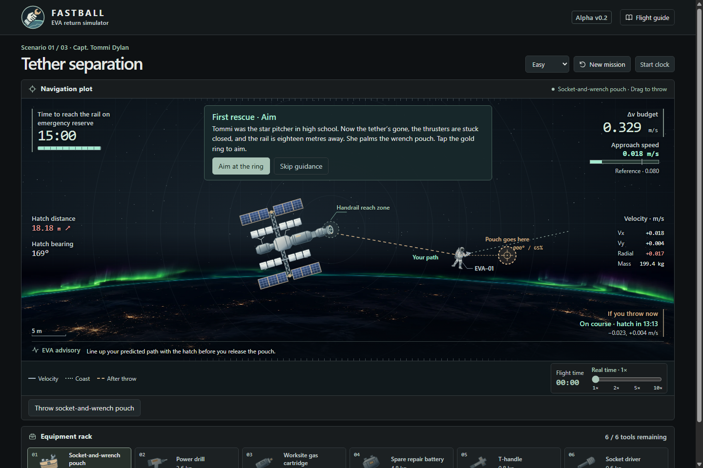

# Fastball · Alpha v0.2

Capt. Tommi Dylan (she/they) was the first test pilot to break Mach 10 in the classified SR-73 reconnaissance craft. These days she spends Saturdays pitching with friends, sometimes against the next town over. Now her tether has snapped and the thrusters on her lightweight prototype suit are stuck closed. Eighteen metres from the handrail, the former high school star pitcher reaches for the wrench pouch.

## Play

Open `index.html` in a browser to play offline. The first rescue walks you through pitching the pouch and checking your course when the original gap to the handrail reach zone has halved. Each flight gets one halfway call. The approach gauge shows your speed relative to the station in all four modes. Its faint 0.080 m/s mark on Story and Easy becomes a firm capture limit on Medium and Hard.

Pick a tool from the rack. Drag on the navigation plot to set direction and power, then release to throw. On the keyboard, press 1-6 to select a tool, focus the plot, use the arrow keys to aim and set power, and press Enter to throw. The flight clock at the lower right of the HUD has a slider for 1×, 2×, 5× and 10×. Its readout turns amber during fast-forward. The **Flight guide** is available during any mission.

The station gives Tommi a different welcome on each difficulty. Reach the rail with the original power drill still holstered to earn **Upmass Hero**, whichever bonus objective you chose.
